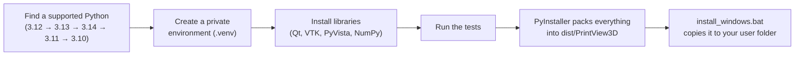

<p align="center">
  
</p>

<h1 align="center">PrintView3D</h1>

<p align="center">
  A fast, free Windows viewer for <b>STL</b>, <b>3MF</b> and <b>G-code</b> files,<br>
  with a one-click button that opens the file in <b>your slicer</b>.
</p>

<p align="center">
  <a href="../../releases/latest"><b>⬇ Download for Windows</b></a> ·
  <a href="#install">Install</a> ·
  <a href="#using-printview3d">How to use</a> ·
  <a href="#build-it-yourself">Build it yourself</a> ·
  <a href="CHANGELOG.md">What's new</a>
</p>


Microsoft retired its **3D Viewer** app. PrintView3D replaces it, and is made for people who 3D-print:
it shows models *and* sliced G-code, tells you the size, print time and filament use, and sends the
file to Creality Print, OrcaSlicer, Bambu Studio, PrusaSlicer, Cura and others with one click.

---

## Features

| | |
|---|---|
| **STL** | Smooth-shaded model on a build plate, with size, triangle count and volume. |
| **3MF** | Every object on the plate, including projects from Creality Print, OrcaSlicer and Bambu Studio. Show or hide each object, see the project's printer and filament settings and its thumbnail. If the project is already sliced, view its toolpaths without re-slicing. |
| **G-code** | Toolpaths coloured by type (walls, infill, top/bottom, supports, bridges, travel…), a layer slider, "show only this layer", print time, filament use and the slicer's preview picture. |
| **Open in your slicer** | One click (or `Ctrl+P`) opens the current file in your slicer. Installed slicers are found automatically. |
| **Default app** | Optional: make PrintView3D open `.stl`, `.3mf` and `.gcode` files when you double-click them. Fully reversible. |
| **Comfortable to use** | Slicer-style camera, drag & drop, recent files, screenshots, dark theme. |

<table>
<tr>
<td width="50%"><br><sub>3MF project: every object listed, each can be hidden.</sub></td>
<td width="50%"><br><sub>"Show only this layer": walls and infill of a single layer.</sub></td>
</tr>
<tr>
<td width="50%"><br><sub>STL model with size and volume.</sub></td>
<td width="50%"><br><sub>The ▾ arrow sends the file to another slicer just once.</sub></td>
</tr>
</table>

### Supported slicers

Found automatically when installed:

**Creality Print · OrcaSlicer · Bambu Studio · PrusaSlicer · UltiMaker Cura · Elegoo Slicer · Anycubic Slicer Next**

Any other slicer works too: choose it as **Custom** in Settings.

---

## Install

You do **not** need Python or anything else to use PrintView3D.

1. Go to the **[latest release](../../releases/latest)** and download **`PrintView3D-windows.zip`**.
2. Right-click the zip → **Extract All…** and extract it to a folder of your choice.
3. Open the extracted folder and double-click **`install_windows.bat`**.
   - It copies PrintView3D to `%LOCALAPPDATA%\Programs\PrintView3D` (no admin rights needed),
     adds it to the Start menu, and asks whether you also want a desktop shortcut.
4. PrintView3D starts. Done.

> **"Windows protected your PC"?** PrintView3D is not code-signed (signing certificates cost money
> every year), so Windows SmartScreen may warn the first time. Click **More info → Run anyway**.
> All the source code is in this repository, and every release is built automatically by
> [GitHub Actions](../../actions) from that code.

**Portable use:** you can also just run `PrintView3D.exe` straight from the extracted folder without
installing.

### Make it the default program for 3D files (optional)

1. In PrintView3D, click **Settings**.
2. Under *Default program for 3D files*, click **Register & choose as default…**.
3. Windows Settings opens. Pick **PrintView3D** for `.stl`, `.3mf` and `.gcode`.

Windows requires you to confirm this last step yourself; no program is allowed to do it silently.
**Remove registration** in the same place undoes everything.

### Uninstall

Double-click **`uninstall_windows.bat`** (in the extracted folder). It removes the file associations,
shortcuts and the program. It asks before deleting your settings.

---

## Using PrintView3D

**Open a file:** double-click it (if PrintView3D is the default), drag it onto the window, use
**Open**, or pick it from **Recent**. Try the files in [`examples/`](examples) to get started.

### Mouse

| Action | What it does |
|---|---|
| **Left-drag** | Rotate. Press *on the model* to rotate around that exact point; press on empty space to rotate around the model's centre. The plate always stays level. |
| **Right-drag** (or middle-drag, or Shift + left-drag) | Move (pan) |
| **Mouse wheel** | Zoom towards the mouse pointer |

Looking from underneath? The plate gets out of the way so you can see the bottom of the part.

### Keyboard

| Key | Action |
|---|---|
| `Ctrl+O` | Open a file |
| `Ctrl+P` | Open the file in your default slicer |
| `F` · `1` · `2` · `3` · `4` | Fit · Iso · Top · Front · Right view |
| `↑` / `↓` | Next / previous layer (G-code) |
| `Page Up` / `Page Down` | 10 layers up / down |
| `Home` / `End` | First / last layer |

### Choosing your slicer


**Settings → Slicer → Default slicer.** Each slicer is marked *installed* or *not found*. If yours
is installed in an unusual place, click **Browse…** and select its program file. For a slicer that
is not in the list, choose **Custom program…**, give it a name and select its `.exe`.

The green button is renamed to match ("Open in OrcaSlicer"). The small **▾** arrow next to it lists
your other installed slicers, for opening a file in one of them just once.

### Smoother rotation on laptops

Many laptops have two graphics chips and run programs on the slower one by default.
**Settings → Graphics** shows which one PrintView3D uses. If it says *Intel*, tick
**Use the high-performance graphics card** and restart PrintView3D.

---

## Build it yourself

Only needed if you want to change the code or don't want to use the ready-made download.

### Step 1: Install the right Python version ⚠️

PrintView3D uses **VTK** for its 3D drawing, and VTK only supports certain Python versions.
**The newest Python is often *not* supported yet**, and python.org's big download button always
gives you the newest one.

| Python version | Works? |
|---|---|
| 3.10, 3.11 | ✅ Yes |
| **3.12** | ✅ **Yes, recommended** (what the official builds use) |
| 3.13, 3.14 | ✅ Yes |
| 3.15 and newer | ❌ Not yet (no VTK version for it) |

**Already have Python?** Check which versions you have: open *Command Prompt* and type `py --list`.

**Install Python 3.12**, using one of these:

- **Easiest**, in *Command Prompt* or *PowerShell*:
  ```
  winget install Python.Python.3.12
  ```
- **Or** from python.org: go to [python.org/downloads/windows](https://www.python.org/downloads/windows/),
  find the latest **Python 3.12.x** release and download the *Windows installer (64-bit)*.
  During setup, tick **"Add python.exe to PATH"** *only if* you have no other Python installed.

> You can keep several Python versions side by side; they don't interfere with each other. The
> build script automatically picks a supported one (3.12 first), so an existing newer Python is not
> a problem.

### Step 2: Get the code

Either click the green **Code → Download ZIP** button on this page and extract it, or:

```
git clone https://github.com/sevagjb/PrintView3D.git
```

### Step 3: Build

Double-click **`build_windows.bat`** in the project folder (or run it from a terminal).
The first build takes a few minutes; later builds are faster. Then run **`install_windows.bat`**.

### What the build script does



1. **Find Python.** It asks the Windows `py` launcher for 3.12, then 3.13, 3.14, 3.11, 3.10, and
   uses the first one it finds. If none is installed, it stops and tells you what to install.
2. **Create `.venv`.** A private folder with its own copy of the libraries, so nothing is installed
   into your system Python and nothing else on your PC is affected. Delete `.venv` to start fresh.
3. **Install libraries** listed in `requirements.txt` (the app) and `requirements-build.txt`
   (PyInstaller and pytest).
4. **Run the tests** in `tests/`. The build stops if any test fails.
5. **Package.** PyInstaller collects Python, the libraries and the app into
   `dist\PrintView3D\PrintView3D.exe` plus an `_internal` folder. That folder is the finished
   program and runs on any Windows 10/11 PC without Python. It is large (several hundred MB),
   mainly because of the VTK 3D engine.

### Troubleshooting the build

| Problem | Fix |
|---|---|
| `No supported Python version was found` | Install Python 3.12 (Step 1). |
| `Python was not found` / `'py' is not recognized` | Install Python from python.org or with winget (Step 1); both include the `py` launcher. |
| Build fails while installing `vtk` | You are on an unsupported Python. Delete the `.venv` folder, install 3.12, run the build again. |
| Tests fail | Please [open an issue](../../issues) and paste the output. |
| Windows Defender deletes or blocks the `.exe` | A known false alarm with PyInstaller programs. Allow it in *Windows Security → Protection history*. |

### Developing

```bat
run_from_source.bat                    :: start from the source code, no packaging
.venv\Scripts\python -m pytest -q      :: run the tests
.venv\Scripts\python tools\make_demo.py         :: regenerate examples\
.venv\Scripts\python tools\make_screenshots.py  :: regenerate the README pictures
```

```
src/printview3d/
  app.py              entry point and command-line options
  loaders/gcode.py    G-code reader (layers, feature types, print info, thumbnails)
  loaders/mesh.py     STL and 3MF readers
  slicer.py           list of slicers, detection and launching
  file_assoc.py       Windows "Open with" / default-app registration (current user only)
  gpu.py              graphics-card info and high-performance GPU setting
  settings.py         settings file: %APPDATA%\PrintView3D\settings.json
  ui/                 window, 3D scene, camera controls, settings dialog, theme
tests/                automated tests and sample files
tools/                demo-file and screenshot generators
printview3d.spec      PyInstaller recipe
```

**Automatic builds:** every push builds and tests the Windows program on GitHub
([Actions](../../actions)). When the version number in `src/printview3d/__init__.py` changes,
it also publishes a new [release](../../releases) with `PrintView3D-windows.zip` attached.

### Command line

```
PrintView3D.exe model.stl                          open a file
PrintView3D.exe part.gcode --screenshot out.png    save a picture and exit
                     [--layer 25] [--view iso|top|front|right]
PrintView3D.exe --unregister                       remove file associations
```

---

## Contributing

Bug reports, ideas and pull requests are welcome; see [CONTRIBUTING.md](CONTRIBUTING.md).
Is your slicer missing? It is usually a single entry in `SLICERS` in
[`src/printview3d/slicer.py`](src/printview3d/slicer.py).

## Notes and limits

- Windows 10 and 11. The code also runs on Linux/macOS from source, but only Windows is packaged
  and tested.
- A 3MF *project* saved in one brand of slicer may lose its printer/print settings when opened in a
  different brand. The model itself loads fine; that's how the slicers behave.
- Binary G-code (`.bgcode`) is not supported yet.

## License

[MIT](LICENSE). Free to use, change and share.
Built with [Qt for Python](https://doc.qt.io/qtforpython/), [PyVista](https://pyvista.org) and
[VTK](https://vtk.org).
