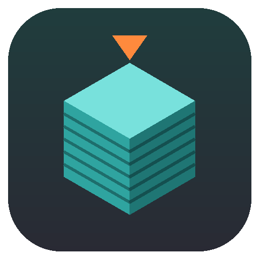
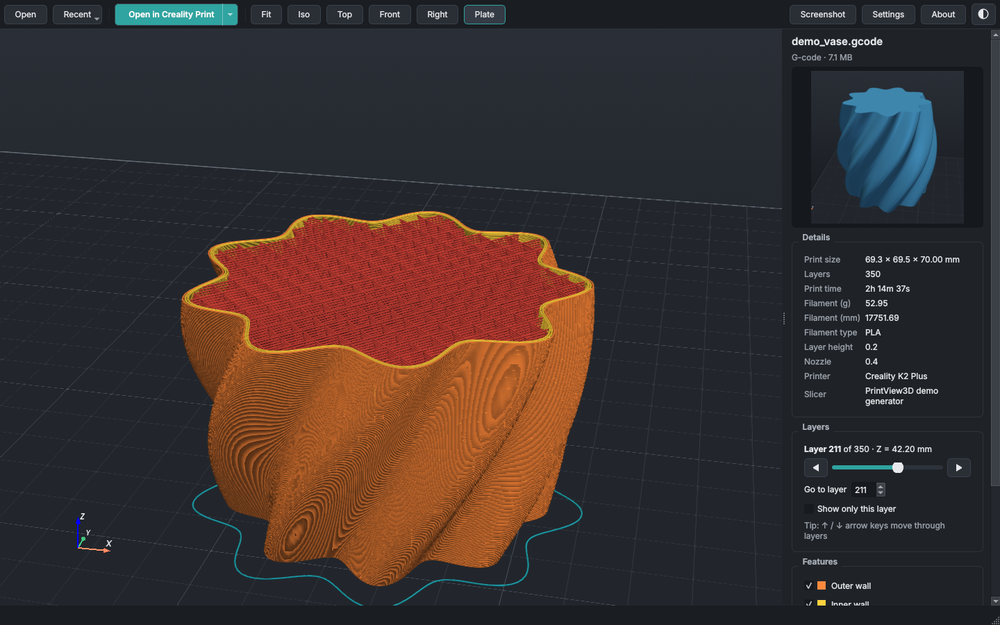
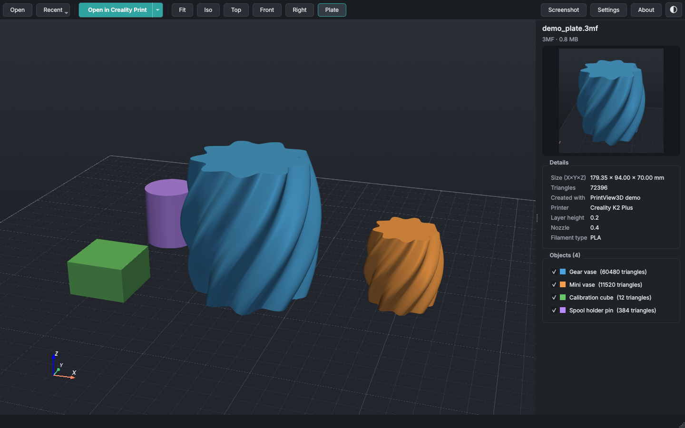
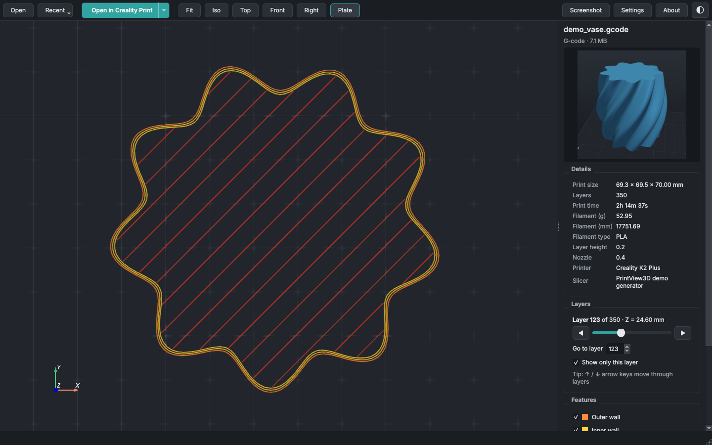
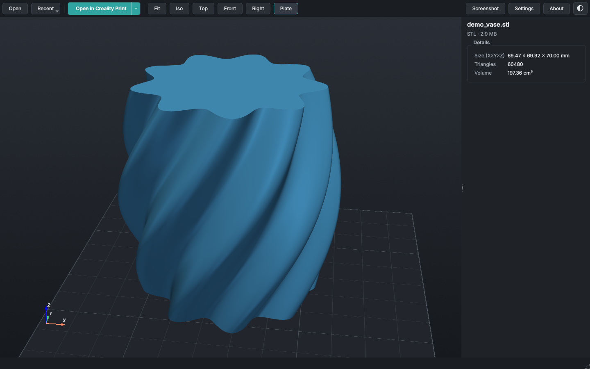
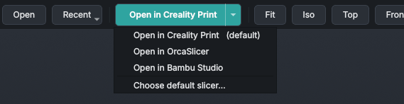
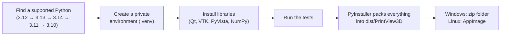
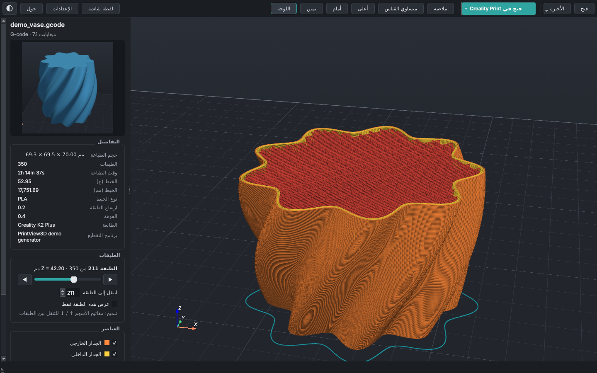

<p align="center">
  
</p>

<h1 align="center">PrintView3D</h1>

<p align="center">
  A fast, free viewer for <b>STL</b>, <b>3MF</b> and <b>G-code</b> files on <b>Windows</b> and <b>Linux</b>,<br>
  with a one-click button that opens the file in <b>your slicer</b>.
</p>

<p align="center">
  <a href="../../releases/latest"><b>⬇ Download</b></a> ·
  <a href="#windows">Windows</a> ·
  <a href="#linux">Linux</a> ·
  <a href="#macos">macOS</a> ·
  <a href="#using-printview3d">How to use</a> ·
  <a href="#build-it-yourself">Build it yourself</a> ·
  <a href="CHANGELOG.md">What's new</a>
</p>



Microsoft retired its **3D Viewer** app, and Linux never had a good one. PrintView3D fills the gap, made for people who 3D-print:
it shows models *and* sliced G-code, tells you the size, print time and filament use, and sends the
file to Creality Print, OrcaSlicer, Bambu Studio, PrusaSlicer, Cura and others with one click.

---

## Features

| | |
|---|---|
| **STL** | Smooth-shaded model on a build plate, with size, triangle count and volume. |
| **3MF** | Every object on the plate, including projects from Creality Print, OrcaSlicer and Bambu Studio. Show or hide each object, see the project's printer and filament settings and its thumbnail. If the project is already sliced, view its toolpaths without re-slicing. |
| **G-code** | Toolpaths coloured by type (walls, infill, top/bottom, supports, bridges, travel…), a layer slider, "show only this layer", print time, filament use and the slicer's preview picture. |
| **Open in your slicer** | One click (or `Ctrl+P`) opens the current file in your slicer. Installed slicers are found automatically. |
| **Default app** | Optional: make PrintView3D open `.stl`, `.3mf` and `.gcode` files when you double-click them. Fully reversible. |
| **Your language** | English, العربية (Arabic, right-to-left), Nederlands, Deutsch, Français and Español; switch any time in Settings, no restart needed. [Help translate](#translations). |
| **Themes** | Automatic (follows your system), Dark, Gray, Graphite (warm, easy on the eyes) or Light, for the window and the 3D view. Switch with one click on ◐ or `Ctrl+T`. Toolpath colours stay the same in every theme. |
| **Comfortable to use** | Slicer-style camera, drag & drop, recent files, screenshots. |

<table>
<tr>
<td width="50%"><br><sub>3MF project: every object listed, each can be hidden.</sub></td>
<td width="50%"><br><sub>"Show only this layer": walls and infill of a single layer.</sub></td>
</tr>
<tr>
<td width="50%"><br><sub>STL model with size and volume.</sub></td>
<td width="50%"><br><sub>The ▾ arrow sends the file to another slicer just once.</sub></td>
</tr>
</table>

### Supported slicers

Found automatically when installed:

**Creality Print · OrcaSlicer · Bambu Studio · PrusaSlicer · UltiMaker Cura · Elegoo Slicer · Anycubic Slicer Next**

Any other slicer works too: choose it as **Custom** in Settings.

---

## Install

You do **not** need Python or anything else to use PrintView3D. Pick your system:

| System | Download | |
|---|---|---|
| **Windows 10 / 11** | `PrintView3D-windows.zip` | [Instructions](#windows) |
| **Linux** (64-bit, x86-64) | `PrintView3D-x86_64.AppImage` | [Instructions](#linux) |
| **macOS** | on request | [Read this](#macos) |

All downloads are on the **[latest release](../../releases/latest)** page.

### Windows

1. Go to the **[latest release](../../releases/latest)** and download **`PrintView3D-windows.zip`**.
2. Right-click the zip → **Extract All…** and extract it to a folder of your choice.
3. Open the extracted folder and double-click **`install_windows.bat`**.
   - It copies PrintView3D to `%LOCALAPPDATA%\Programs\PrintView3D` (no admin rights needed),
     adds it to the Start menu, and asks whether you also want a desktop shortcut.
4. PrintView3D starts. Done.

> **"Windows protected your PC"?** PrintView3D is not code-signed (signing certificates cost money
> every year), so Windows SmartScreen may warn the first time. Click **More info → Run anyway**.
> All the source code is in this repository, and every release is built automatically by
> [GitHub Actions](../../actions) from that code.

**Portable use:** you can also just run `PrintView3D.exe` straight from the extracted folder without
installing.

#### Make it the default program for 3D files (optional)

1. In PrintView3D, click **Settings**.
2. Under *Default program for 3D files*, click **Register & choose as default…**.
3. Windows Settings opens. Pick **PrintView3D** for `.stl`, `.3mf` and `.gcode`.

Windows requires you to confirm this last step yourself; no program is allowed to do it silently.
**Remove registration** in the same place undoes everything.

#### Uninstall

Double-click **`uninstall_windows.bat`** (in the extracted folder). It removes the file associations,
shortcuts and the program. It asks before deleting your settings.

### Linux

PrintView3D for Linux is a single **AppImage** file: it contains everything it needs and runs on
most distributions without installing packages: Ubuntu 22.04 or newer, Linux Mint 21+, Debian 12+,
Fedora 36+, openSUSE Tumbleweed, Arch, Manjaro, Pop!_OS, elementary OS, Zorin OS and others.

1. Download **`PrintView3D-x86_64.AppImage`** from the **[latest release](../../releases/latest)**.
2. Make it executable: right-click it → **Properties → Permissions → Allow executing file as
   program**, or in a terminal:
   ```bash
   chmod +x PrintView3D-x86_64.AppImage
   ```
3. Double-click it, or run `./PrintView3D-x86_64.AppImage`.

**Add it to your applications menu** (optional, recommended): in PrintView3D open **Settings** and
click **Register & make default**. PrintView3D then appears in your applications menu and in
"Open With", and opens `.stl`, `.3mf` and `.gcode` files on double-click. On Linux this takes effect
immediately; **Remove registration** undoes it.

Tip: keep the AppImage in a fixed place such as `~/Applications` before registering, because the
menu entry points to wherever the file is. Or let the script do it all:

```bash
./install_linux.sh PrintView3D-x86_64.AppImage     # copies to ~/Applications + adds the menu entry
./uninstall_linux.sh                               # removes it again
```

(The two scripts are in the [source code](../../archive/refs/heads/main.zip).)

**Slicers on Linux** are found automatically when installed as an AppImage (in `~/Applications`,
`~/Downloads`, `~/Desktop`, `~/bin`, `/opt`…), as a **Flatpak** or **Snap**, from your
distribution's packages, or in `/opt`. Otherwise choose it once with **Browse…** in Settings.

<details>
<summary><b>Linux troubleshooting</b></summary>

| Problem | Fix |
|---|---|
| Nothing happens / "AppImages require FUSE" | Install FUSE: `sudo apt install libfuse2` (Ubuntu/Debian), `sudo dnf install fuse fuse-libs` (Fedora). Or run it without FUSE: `./PrintView3D-x86_64.AppImage --appimage-extract-and-run` |
| `GLIBC_2.35 not found` | Your distribution is older than Ubuntu 22.04 / Debian 12. Build from source instead (below). |
| Window opens but the 3D view stays black | Make sure your graphics driver is installed (Mesa or the NVIDIA driver). In a virtual machine, enable 3D acceleration. |
| Wayland desktop | Supported. PrintView3D automatically runs through XWayland, because the 3D view needs it. |
| Slow rotation on a laptop with two GPUs | Start PrintView3D from the applications menu after **Register** (the menu entry asks for the dedicated GPU), or use your desktop's *Launch using Dedicated Graphics Card* option. |

</details>

### macOS

The code already runs on macOS, but there is **no ready-made Mac download yet**, because nobody has
tried it on a real Mac so far. **Would you like to use PrintView3D on your Mac? We can build a Mac
version for you.** [Open a Mac build request](../../issues/new?template=mac_build.md) and tell us your
Mac model and macOS version. Your feedback is what makes an official Mac release possible.

Comfortable with a terminal? You can try running it from source on macOS: install Python 3.12 from
python.org, run `./build_linux.sh --no-appimage` once to set everything up, then
`./run_from_source.sh`. This is not tested on a Mac yet, so please tell us how it goes.

---

## Using PrintView3D

**Open a file:** double-click it (if PrintView3D is the default), drag it onto the window, use
**Open**, or pick it from **Recent**. Try the files in [`examples/`](examples) to get started.

### Mouse

| Action | What it does |
|---|---|
| **Left-drag** | Rotate. Press *on the model* to rotate around that exact point; press on empty space to rotate around the model's centre. The plate always stays level. |
| **Right-drag** (or middle-drag, or Shift + left-drag) | Move (pan) |
| **Mouse wheel** | Zoom towards the mouse pointer |

Looking from underneath? The plate gets out of the way so you can see the bottom of the part.

### Keyboard

| Key | Action |
|---|---|
| `Ctrl+O` | Open a file |
| `Ctrl+P` | Open the file in your default slicer |
| `Ctrl+T` | Next theme (Dark → Gray → Graphite → Light) |
| `F` · `1` · `2` · `3` · `4` | Fit · Iso · Top · Front · Right view |
| `↑` / `↓` | Next / previous layer (G-code) |
| `Page Up` / `Page Down` | 10 layers up / down |
| `Home` / `End` | First / last layer |

### Choosing your slicer


**Settings → Slicer → Default slicer.** Each slicer is marked *installed* or *not found*. If yours
is installed in an unusual place, click **Browse…** and select its program file. For a slicer that
is not in the list, choose **Custom program…**, give it a name and select its `.exe`.

The green button is renamed to match ("Open in OrcaSlicer"). The small **▾** arrow next to it lists
your other installed slicers, for opening a file in one of them just once.

### Language

**Settings → Language** switches the whole program immediately, including file dialogs and
standard buttons. English is the default; *Automatic* follows your system language. Arabic uses a
right-to-left layout; measurements always use Western digits (0.20 mm).

### Themes

Click the **◐ icon** at the right end of the toolbar to pick a theme, or press **`Ctrl+T`** to
step to the next one. The same choice is in **Settings → Appearance → Theme**.

- **Automatic** follows the dark/light setting of Windows or your Linux desktop (and switches
  along when that changes).
- **Dark**, **Gray**, **Graphite** (a warm, dark brownish tone that is soft on the eyes) or **Light**.

The switch is immediate; the 3D background, plate and grid change with it, while G-code and
model colours stay the same so they always match your slicer.


### Smoother rotation on laptops

Many laptops have two graphics chips and run programs on the slower one by default.
**Settings → Graphics** shows which one PrintView3D uses. If it says *Intel*, tick
**Use the high-performance graphics card** and restart PrintView3D.

---

## Build it yourself

Only needed if you want to change the code or don't want to use the ready-made download.

### Step 1: Install the right Python version ⚠️

PrintView3D uses **VTK** for its 3D drawing, and VTK only supports certain Python versions.
**The newest Python is often *not* supported yet**, and python.org's big download button always
gives you the newest one.

| Python version | Works? |
|---|---|
| 3.10, 3.11 | ✅ Yes |
| **3.12** | ✅ **Yes, recommended** (what the official builds use) |
| 3.13, 3.14 | ✅ Yes |
| 3.15 and newer | ❌ Not yet (no VTK version for it) |

#### Windows

**Already have Python?** Check which versions you have: open *Command Prompt* and type `py --list`.

**Install Python 3.12**, using one of these:

- **Easiest**, in *Command Prompt* or *PowerShell*:
  ```
  winget install Python.Python.3.12
  ```
- **Or** from python.org: go to [python.org/downloads/windows](https://www.python.org/downloads/windows/),
  find the latest **Python 3.12.x** release and download the *Windows installer (64-bit)*.
  During setup, tick **"Add python.exe to PATH"** *only if* you have no other Python installed.

#### Linux

Check with `python3 --version`. If it says 3.15 or newer, install 3.12 next to it:

| Distribution | Command |
|---|---|
| Ubuntu / Mint / Pop!_OS | `sudo apt install python3.12 python3.12-venv` (on older Ubuntu first: `sudo add-apt-repository ppa:deadsnakes/ppa`) |
| Debian | `sudo apt install python3 python3-venv` (Debian 12/13 ship a supported version) |
| Fedora | `sudo dnf install python3.12` |
| Arch / Manjaro | `yay -S python312`, or use [pyenv](https://github.com/pyenv/pyenv) |

You also need `curl` and `git` (usually already installed).

> You can keep several Python versions side by side; they don't interfere with each other. The
> build scripts automatically pick a supported one (3.12 first), so an existing newer Python is not
> a problem.

### Step 2: Get the code

Either click the green **Code → Download ZIP** button on this page and extract it, or:

```
git clone https://github.com/sevagjb/PrintView3D.git
```

### Step 3: Build

**Windows:** double-click **`build_windows.bat`** in the project folder (or run it from a terminal).
Then run **`install_windows.bat`**.

**Linux:** in a terminal, in the project folder:

```bash
./build_linux.sh          # makes dist/PrintView3D-x86_64.AppImage
./install_linux.sh        # optional: copy to ~/Applications + add to the applications menu
```

The first build takes a few minutes (it downloads about 300 MB of libraries); later builds are faster.

### What the build script does



1. **Find Python.** It looks for 3.12, then 3.13, 3.14, 3.11, 3.10 (Windows: through the `py`
   launcher; Linux: `python3.12`, `python3.13`, …) and uses the first one it finds. If none is
   installed, it stops and tells you what to install.
2. **Create `.venv`.** A private folder with its own copy of the libraries, so nothing is installed
   into your system Python and nothing else on your PC is affected. Delete `.venv` to start fresh.
3. **Install libraries** listed in `requirements.txt` (the app) and `requirements-build.txt`
   (PyInstaller and pytest).
4. **Run the tests** in `tests/`. The build stops if any test fails.
5. **Package.** PyInstaller collects Python, the libraries and the app into
   `dist\PrintView3D\PrintView3D.exe` plus an `_internal` folder. That folder is the finished
   program and runs on any Windows 10/11 PC without Python. It is large (several hundred MB),
   mainly because of the VTK 3D engine.
6. **Linux only: AppImage.** `build_linux.sh` downloads
   [appimagetool](https://github.com/AppImage/appimagetool) once and packs `dist/PrintView3D/` into
   the single file `dist/PrintView3D-x86_64.AppImage`. (`--no-appimage` skips this step.)

### Troubleshooting the build

| Problem | Fix |
|---|---|
| `No supported Python version was found` | Install Python 3.12 (Step 1). |
| `Python was not found` / `'py' is not recognized` | Install Python from python.org or with winget (Step 1); both include the `py` launcher. |
| Linux: `Could not create a virtual environment` | Install the venv module, e.g. `sudo apt install python3.12-venv`. |
| Linux: `qt.qpa.plugin: Could not load the Qt platform plugin "xcb"` when running from source | Install Qt's X11 helper: `sudo apt install libxcb-cursor0` (Fedora: `xcb-util-cursor`). The AppImage already includes it. |
| Build fails while installing `vtk` | You are on an unsupported Python. Delete the `.venv` folder, install 3.12, run the build again. |
| Tests fail | Please [open an issue](../../issues) and paste the output. |
| Windows Defender deletes or blocks the `.exe` | A known false alarm with PyInstaller programs. Allow it in *Windows Security → Protection history*. |

### Developing

```bat
run_from_source.bat                    :: start from the source code, no packaging (Linux: ./run_from_source.sh)
.venv\Scripts\python -m pytest -q      :: run the tests
.venv\Scripts\python tools\make_demo.py         :: regenerate examples\
.venv\Scripts\python tools\make_screenshots.py  :: regenerate the README pictures
```

```
src/printview3d/
  app.py              entry point and command-line options
  loaders/gcode.py    G-code reader (layers, feature types, print info, thumbnails)
  loaders/mesh.py     STL and 3MF readers
  slicer.py           list of slicers, detection and launching
  file_assoc.py       "Open with" / default app (assoc_windows.py: registry, assoc_linux.py: freedesktop)
  gpu.py              graphics-card info and high-performance GPU setting
  settings.py         settings file: %APPDATA%\PrintView3D\settings.json
  ui/                 window, 3D scene, camera controls, settings dialog, theme
tests/                automated tests and sample files
tools/                demo-file and screenshot generators
packaging/linux/      AppImage launcher and menu entry
printview3d.spec      PyInstaller recipe (Windows and Linux)
```

**Automatic builds:** every push builds and tests the Windows program on GitHub
([Actions](../../actions)). When the version number in `src/printview3d/__init__.py` changes,
it also publishes a new [release](../../releases) with the Windows zip and the Linux AppImage
attached.

### Command line

```
PrintView3D.exe model.stl                          open a file
PrintView3D.exe part.gcode --screenshot out.png    save a picture and exit
                     [--layer 25] [--view iso|top|front|right]
PrintView3D.exe model.stl --send-to-slicer         open the file in your default slicer and exit
PrintView3D.exe model.stl --send-to-slicer orcaslicer   ...or in a specific one
PrintView3D.exe --lang ar                          start in a language (en, ar, nl, de, fr, es)
PrintView3D.exe --theme light                      start with a theme (auto, dark, gray, graphite, light)
PrintView3D.exe --register                         add to "Open with" (Linux: also the applications menu)
PrintView3D.exe --unregister                       remove file associations
(on Linux use ./PrintView3D-x86_64.AppImage instead of PrintView3D.exe)
```

---

## Translations

| Language | Status |
|---|---|
| English | Source language |
| العربية Arabic | Complete, reviewed by a native speaker |
| Nederlands | Complete, needs review by a native speaker |
| Deutsch | Complete, needs review by a native speaker |
| Français | Complete, needs review by a native speaker |
| Español | Complete, needs review by a native speaker |

**Speak one of these languages? Or want PrintView3D in yours?** Your help is very welcome:
spotting one wrong word already helps. See [CONTRIBUTING.md → Translations](CONTRIBUTING.md#translations).
Untranslated texts simply appear in English, so a language can be added step by step.



[](https://hosted.weblate.org/engage/printview3d/)

## Contributing

Bug reports, ideas and pull requests are welcome; see [CONTRIBUTING.md](CONTRIBUTING.md).
Is your slicer missing? It is usually a single entry in `SLICERS` in
[`src/printview3d/slicer.py`](src/printview3d/slicer.py).

## Notes and limits

- Windows 10/11 and Linux (x86-64) are packaged and tested. macOS runs from source; a packaged Mac
  version is [available on request](#macos). ARM Linux (Raspberry Pi etc.) is not packaged yet.
- A 3MF *project* saved in one brand of slicer may lose its printer/print settings when opened in a
  different brand. The model itself loads fine; that's how the slicers behave.
- Binary G-code (`.bgcode`) is not supported yet.

## License

[MIT](LICENSE). Free to use, change and share.
Built with [Qt for Python](https://doc.qt.io/qtforpython/), [PyVista](https://pyvista.org) and
[VTK](https://vtk.org).
