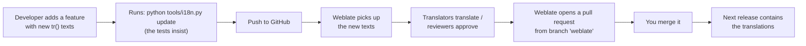

# Connecting PrintView3D to Weblate

This guide is for the project maintainer. It is done **once**; afterwards translations flow
between Weblate and GitHub automatically.

**What you get:** translators work in the browser on [Hosted Weblate](https://hosted.weblate.org).
When the code gets new texts, they appear on Weblate automatically. Finished translations come back
to GitHub as a pull request that you only need to merge.

> Weblate's menus change from time to time; if a button is named slightly differently, look for the
> closest match.

---

## 1. Account (already done?)

1. Go to <https://hosted.weblate.org> → **Register** → **Sign in with GitHub**.
2. Profile (top right) → **Settings → Languages** → add the languages you translate (e.g. Arabic).

## 2. Create the project (starts the free 14-day setup period)

Free ("Libre") hosting is for public, open-source projects. PrintView3D qualifies: public repository,
MIT license. You get **14 days** to set it up, then you request approval to keep it free.

1. On Hosted Weblate, choose **Add new translation project** (or **Hosting → Libre / free for open
   source** if it asks for a plan first).
2. Project details:
   | Field | Value |
   |---|---|
   | Project name | `PrintView3D` |
   | URL slug | `printview3d` |
   | Project website | `https://github.com/sevagjb/PrintView3D` |
   | Translation instructions (optional) | `https://github.com/sevagjb/PrintView3D/blob/main/CONTRIBUTING.md#translations` |

## 3. Connect GitHub (lets Weblate read the files and send pull requests)

1. In the project (or your workspace), choose **Connect GitHub account**.
2. GitHub asks you to install the **Hosted Weblate** app (<https://github.com/apps/hosted-weblate>).
   Choose **Only select repositories → PrintView3D** and confirm.
   - The app is what lets Weblate read the repository and open pull requests. You don't need a
     webhook or to invite any Weblate user; the app handles both.

## 4. Add the translation component

Choose **Add new translation component → From your connected GitHub account**, pick
`sevagjb/PrintView3D`, and use:

| Field | Value |
|---|---|
| Component name | `Application` |
| Repository branch | `main` |
| File format | **Qt Linguist translation file** |
| File mask | `translations/printview3d_*.ts` |
| Monolingual base language file | *(leave empty)* |
| Template for new translations | `translations/printview3d.ts` |
| Source language | English |
| Push branch | `weblate` |
| Version control system | **GitHub** (via the Weblate GitHub app), so changes arrive as pull requests |

Weblate should now find **Arabic, Dutch, French, German and Spanish**, each 100 % translated but
marked **"Needs editing"**. That is intentional: they are first drafts waiting for review by native
speakers.

Recommended component settings (**Manage → Settings**):
- **Translation → Enable suggestions**: on. **Suggestion voting**: on, if you want the community to
  vote on suggestions.
- **Commit messages → Push on commit**: on.
- **Workflow → Translation review**: on. Translators then fill in texts and trusted reviewers approve
  them; you can give reviewer rights per language under **Manage → Users**.

## 5. Glossary (keeps 3D-printing terms consistent)

Weblate creates a **Glossary** component for the project automatically. Add the important terms
once per language: *wall, infill, layer, nozzle, slicer, build plate, support, brim, skirt*. When a
translator later translates "Sparse infill", Weblate shows the agreed word for "infill".

## 6. Request approval (within the 14 days)

Project → **Manage → Billing** (or the banner at the top) → **Request project approval**.
Mention that it is an MIT-licensed open-source project: <https://github.com/sevagjb/PrintView3D>.
Approval keeps the project free permanently.

## 7. After approval

- Tell me (or edit the README) to add the Weblate status badge in the **Translations** section:
  ```markdown
  [](https://hosted.weblate.org/engage/printview3d/)
  ```
- Share the invitation link `https://hosted.weblate.org/engage/printview3d/` wherever you announce
  PrintView3D.

---

## Day-to-day: what happens automatically



- **Your only regular task:** merge Weblate's pull request now and then, ideally before a release.
- **Missing translations never break anything:** untranslated texts simply show in English.
- **New language:** a translator clicks *Start new translation* on Weblate; it creates the file
  from the template. Afterwards add the language to `LANGUAGES` in `src/printview3d/i18n.py` so it
  appears in Settings (or ask in an issue).

## Without Weblate

Everything also works on GitHub only: translators edit `translations/printview3d_<lang>.ts` with
Qt Linguist (`pyside6-linguist`, included with PySide6) or a text editor, and open a pull request.
See [CONTRIBUTING.md](../CONTRIBUTING.md#translations).
