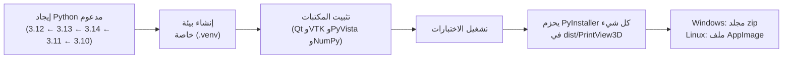

# البناء بنفسك

لا تحتاج إلى ذلك إلا إذا أردت تعديل الشيفرة أو لا تريد استخدام النسخة الجاهزة للتنزيل.

## الخطوة 1: ثبّت إصدار Python المناسب ⚠️ {#step-1-install-the-right-python-version}

يستخدم PrintView3D مكتبة **VTK** للرسم ثلاثي الأبعاد، وVTK لا تدعم إلا إصدارات معيّنة من Python.
**أحدث إصدار من Python غالبًا *غير* مدعوم بعد**، وزر التنزيل الكبير في python.org يعطيك دائمًا الأحدث.

| إصدار Python | هل يعمل؟ |
|---|---|
| 3.10 و3.11 | ✅ نعم |
| **3.12** | ✅ **نعم، ويُنصح به** (هو ما تستخدمه الإصدارات الرسمية) |
| 3.13 و3.14 | ✅ نعم |
| 3.15 وأحدث | ❌ ليس بعد (لا يوجد إصدار VTK له) |

### Windows {#windows}

**لديك Python مسبقًا؟** تحقق من الإصدارات المثبّتة: افتح *موجه الأوامر* (Command Prompt) واكتب `py --list`.

**ثبّت Python 3.12** بإحدى هاتين الطريقتين:

- **الأسهل**، في *موجه الأوامر* أو *PowerShell*:
  ```
  winget install Python.Python.3.12
  ```
- **أو** من python.org: اذهب إلى [python.org/downloads/windows](https://www.python.org/downloads/windows/)،
  وابحث عن أحدث إصدار **Python 3.12.x** ونزّل *Windows installer (64-bit)*.
  أثناء التثبيت، فعّل **«Add python.exe to PATH»** *فقط إذا* لم يكن لديك إصدار Python آخر.

### Linux {#linux}

تحقق بالأمر `python3 --version`. إذا كان 3.15 أو أحدث، فثبّت 3.12 بجانبه:

| التوزيعة | الأمر |
|---|---|
| Ubuntu / Mint / Pop!_OS | `sudo apt install python3.12 python3.12-venv` (على إصدارات Ubuntu الأقدم أولًا: `sudo add-apt-repository ppa:deadsnakes/ppa`) |
| Debian | `sudo apt install python3 python3-venv` (‏Debian 12/13 يأتيان بإصدار مدعوم) |
| Fedora | `sudo dnf install python3.12` |
| Arch / Manjaro | `yay -S python312`، أو استخدم [pyenv](https://github.com/pyenv/pyenv) |

تحتاج أيضًا إلى `curl` و`git` (مثبّتان عادةً).

> يمكنك الاحتفاظ بعدة إصدارات من Python جنبًا إلى جنب؛ لا يتعارض بعضها مع بعض. تختار سكربتات البناء
> تلقائيًا إصدارًا مدعومًا (3.12 أولًا)، فوجود إصدار أحدث ليس مشكلة.

## الخطوة 2: احصل على الشيفرة {#step-2-get-the-code}

إما أن تنقر الزر الأخضر **Code ← Download ZIP** في [صفحة المشروع على GitHub](https://github.com/sevagjb/PrintView3D)
وتستخرج الملف، أو:

```
git clone https://github.com/sevagjb/PrintView3D.git
```

## الخطوة 3: ابنِ البرنامج {#step-3-build}

**Windows:** انقر نقرًا مزدوجًا على **`build_windows.bat`** في مجلد المشروع (أو شغّله من الطرفية).
ثم شغّل **`install_windows.bat`**. إذا كان [Inno Setup 6](https://jrsoftware.org/isinfo.php) مثبّتًا،
فإن البناء يصنع أيضًا المثبّت `dist\PrintView3D-Setup.exe`.

**Linux:** في الطرفية، داخل مجلد المشروع:

```bash
./build_linux.sh          # makes dist/PrintView3D-x86_64.AppImage
./install_linux.sh        # optional: copy to ~/Applications + add to the applications menu
```

يستغرق البناء الأول بضع دقائق (ينزّل نحو 300 MB من المكتبات)؛ والبناء اللاحق أسرع.

## ماذا يفعل سكربت البناء {#what-the-build-script-does}



1. **إيجاد Python.** يبحث عن 3.12، ثم 3.13 و3.14 و3.11 و3.10 (في Windows: عبر مشغّل `py`؛ وفي Linux:
   ‏`python3.12` و`python3.13` و…) ويستخدم أول إصدار يجده. إذا لم يكن أي منها مثبّتًا، يتوقف ويخبرك بما
   يجب تثبيته.
2. **إنشاء `.venv`.** مجلد خاص فيه نسخته الخاصة من المكتبات، فلا يُثبَّت شيء في Python النظام ولا يتأثر
   أي شيء آخر على حاسوبك. احذف `.venv` لتبدأ من جديد.
3. **تثبيت المكتبات** المذكورة في `requirements.txt` (البرنامج) و`requirements-build.txt` (‏PyInstaller
   وpytest).
4. **تشغيل الاختبارات** في `tests/`. يتوقف البناء إذا فشل أي اختبار.
5. **التحزيم.** يجمع PyInstaller لغة Python والمكتبات والبرنامج في `dist\PrintView3D\PrintView3D.exe`
   ومعه مجلد `_internal`. هذا المجلد هو البرنامج الجاهز ويعمل على أي حاسوب Windows 10/11 دون Python.
   حجمه كبير (عدة مئات من الميغابايت)، وذلك أساسًا بسبب محرّك VTK ثلاثي الأبعاد.
6. **في Linux فقط: AppImage.** ينزّل `build_linux.sh` أداة [appimagetool](https://github.com/AppImage/appimagetool)
   مرة واحدة ويحزم `dist/PrintView3D/` في ملف واحد هو `dist/PrintView3D-x86_64.AppImage`.
   (‏`--no-appimage` يتخطى هذه الخطوة.)

## حل مشكلات البناء {#troubleshooting-the-build}

| المشكلة | الحل |
|---|---|
| `No supported Python version was found` | ثبّت Python 3.12 (الخطوة 1). |
| `Python was not found` / ‏`'py' is not recognized` | ثبّت Python من python.org أو بواسطة winget (الخطوة 1)؛ كلاهما يتضمن مشغّل `py`. |
| Linux: ‏`Could not create a virtual environment` | ثبّت وحدة venv، مثلًا `sudo apt install python3.12-venv`. |
| Linux: ‏`qt.qpa.plugin: Could not load the Qt platform plugin "xcb"` عند التشغيل من الشيفرة المصدرية | ثبّت مساعد X11 الخاص بـ Qt: ‏`sudo apt install libxcb-cursor0` (‏Fedora: ‏`xcb-util-cursor`). ملف AppImage يتضمنه مسبقًا. |
| يفشل البناء أثناء تثبيت `vtk` | أنت تستخدم إصدار Python غير مدعوم. احذف مجلد `.venv`، وثبّت 3.12، وأعد البناء. |
| فشل الاختبارات | رجاءً [افتح بلاغًا](https://github.com/sevagjb/PrintView3D/issues) والصق المخرجات. |
| ‏Windows Defender يحذف ملف `.exe` أو يحظره | إنذار خاطئ معروف مع برامج PyInstaller. اسمح به في *Windows Security ← Protection history*. |

## التطوير {#developing}

```bat
run_from_source.bat                    :: start from the source code, no packaging (Linux: ./run_from_source.sh)
.venv\Scripts\python -m pytest -q      :: run the tests
.venv\Scripts\python tools\make_demo.py         :: regenerate examples\
.venv\Scripts\python tools\make_screenshots.py  :: regenerate the README pictures
```

```
src/printview3d/
  app.py              entry point and command-line options
  loaders/gcode.py    G-code reader (layers, feature types, print info, thumbnails)
  loaders/mesh.py     STL and 3MF readers, STL writer (Export STL)
  slicer.py           list of slicers, detection and launching
  file_assoc.py       "Open with" / default app (assoc_windows.py: registry, assoc_linux.py: freedesktop)
  gpu.py              graphics-card info and high-performance GPU setting
  settings.py         settings file: %APPDATA%\PrintView3D\settings.json
  ui/                 window, 3D scene, camera controls, settings dialog, theme
tests/                automated tests and sample files
tools/                demo-file and screenshot generators
packaging/linux/      AppImage launcher and menu entry
printview3d.spec      PyInstaller recipe (Windows and Linux)
```

**البناء التلقائي:** كل دفع (push) يبني البرنامج ويختبره على GitHub
([Actions](https://github.com/sevagjb/PrintView3D/actions)). وعندما يتغيّر رقم الإصدار في
`src/printview3d/__init__.py`، يُنشر أيضًا [إصدار](https://github.com/sevagjb/PrintView3D/releases) جديد
مرفقة به ملفات Windows وLinux وmacOS.

## سطر الأوامر {#command-line}

```
PrintView3D.exe model.stl                          open a file (in the window already open, if any)
PrintView3D.exe model.stl --new-window             open a file in a new window
PrintView3D.exe part.gcode --screenshot out.png    save a picture and exit
                     [--layer 25] [--view iso|top|front|right]
PrintView3D.exe model.stl --send-to-slicer         open the file in your default slicer and exit
PrintView3D.exe model.stl --send-to-slicer orcaslicer   ...or in a specific one
PrintView3D.exe --lang ar                          start in a language (en, ar, nl, de, fr, es)
PrintView3D.exe --theme light                      start with a theme (auto, dark, gray, graphite, light)
PrintView3D.exe --register                         add to "Open with" (Linux: also the applications menu)
PrintView3D.exe --unregister                       remove file associations
(on Linux use ./PrintView3D-x86_64.AppImage instead of PrintView3D.exe)
```

(تعني الخيارات بالترتيب: فتح ملف (في النافذة المفتوحة إن وُجدت)؛ فتح ملف في نافذة جديدة؛ حفظ صورة ثم
الخروج؛ فتح الملف في برنامج التقطيع الافتراضي ثم الخروج، أو في برنامج محدد؛ البدء بلغة معيّنة؛ البدء بسمة
معيّنة؛ الإضافة إلى «فتح باستخدام»؛ إزالة ارتباطات الملفات. في Linux استخدم
`./PrintView3D-x86_64.AppImage` بدل `PrintView3D.exe`.)
