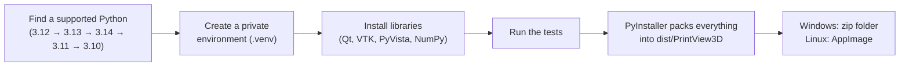

# Build it yourself

Only needed if you want to change the code or don't want to use the ready-made download.

## Step 1: Install the right Python version ⚠️

PrintView3D uses **VTK** for its 3D drawing, and VTK only supports certain Python versions.
**The newest Python is often *not* supported yet**, and python.org's big download button always
gives you the newest one.

| Python version | Works? |
|---|---|
| 3.10, 3.11 | ✅ Yes |
| **3.12** | ✅ **Yes, recommended** (what the official builds use) |
| 3.13, 3.14 | ✅ Yes |
| 3.15 and newer | ❌ Not yet (no VTK version for it) |

### Windows

**Already have Python?** Check which versions you have: open *Command Prompt* and type `py --list`.

**Install Python 3.12**, using one of these:

- **Easiest**, in *Command Prompt* or *PowerShell*:
  ```
  winget install Python.Python.3.12
  ```
- **Or** from python.org: go to [python.org/downloads/windows](https://www.python.org/downloads/windows/),
  find the latest **Python 3.12.x** release and download the *Windows installer (64-bit)*.
  During setup, tick **"Add python.exe to PATH"** *only if* you have no other Python installed.

### Linux

Check with `python3 --version`. If it says 3.15 or newer, install 3.12 next to it:

| Distribution | Command |
|---|---|
| Ubuntu / Mint / Pop!_OS | `sudo apt install python3.12 python3.12-venv` (on older Ubuntu first: `sudo add-apt-repository ppa:deadsnakes/ppa`) |
| Debian | `sudo apt install python3 python3-venv` (Debian 12/13 ship a supported version) |
| Fedora | `sudo dnf install python3.12` |
| Arch / Manjaro | `yay -S python312`, or use [pyenv](https://github.com/pyenv/pyenv) |

You also need `curl` and `git` (usually already installed).

> You can keep several Python versions side by side; they don't interfere with each other. The
> build scripts automatically pick a supported one (3.12 first), so an existing newer Python is not
> a problem.

## Step 2: Get the code

Either click the green **Code → Download ZIP** button on this page and extract it, or:

```
git clone https://github.com/sevagjb/PrintView3D.git
```

## Step 3: Build

**Windows:** double-click **`build_windows.bat`** in the project folder (or run it from a terminal).
Then run **`install_windows.bat`**. If [Inno Setup 6](https://jrsoftware.org/isinfo.php) is
installed, the build also makes the installer `dist\PrintView3D-Setup.exe`.

**Linux:** in a terminal, in the project folder:

```bash
./build_linux.sh          # makes dist/PrintView3D-x86_64.AppImage
./install_linux.sh        # optional: copy to ~/Applications + add to the applications menu
```

The first build takes a few minutes (it downloads about 300 MB of libraries); later builds are faster.

## What the build script does



1. **Find Python.** It looks for 3.12, then 3.13, 3.14, 3.11, 3.10 (Windows: through the `py`
   launcher; Linux: `python3.12`, `python3.13`, …) and uses the first one it finds. If none is
   installed, it stops and tells you what to install.
2. **Create `.venv`.** A private folder with its own copy of the libraries, so nothing is installed
   into your system Python and nothing else on your PC is affected. Delete `.venv` to start fresh.
3. **Install libraries** listed in `requirements.txt` (the app) and `requirements-build.txt`
   (PyInstaller and pytest).
4. **Run the tests** in `tests/`. The build stops if any test fails.
5. **Package.** PyInstaller collects Python, the libraries and the app into
   `dist\PrintView3D\PrintView3D.exe` plus an `_internal` folder. That folder is the finished
   program and runs on any Windows 10/11 PC without Python. It is large (several hundred MB),
   mainly because of the VTK 3D engine.
6. **Linux only: AppImage.** `build_linux.sh` downloads
   [appimagetool](https://github.com/AppImage/appimagetool) once and packs `dist/PrintView3D/` into
   the single file `dist/PrintView3D-x86_64.AppImage`. (`--no-appimage` skips this step.)

## Troubleshooting the build

| Problem | Fix |
|---|---|
| `No supported Python version was found` | Install Python 3.12 (Step 1). |
| `Python was not found` / `'py' is not recognized` | Install Python from python.org or with winget (Step 1); both include the `py` launcher. |
| Linux: `Could not create a virtual environment` | Install the venv module, e.g. `sudo apt install python3.12-venv`. |
| Linux: `qt.qpa.plugin: Could not load the Qt platform plugin "xcb"` when running from source | Install Qt's X11 helper: `sudo apt install libxcb-cursor0` (Fedora: `xcb-util-cursor`). The AppImage already includes it. |
| Build fails while installing `vtk` | You are on an unsupported Python. Delete the `.venv` folder, install 3.12, run the build again. |
| Tests fail | Please [open an issue](https://github.com/sevagjb/PrintView3D/issues) and paste the output. |
| Windows Defender deletes or blocks the `.exe` | A known false alarm with PyInstaller programs. Allow it in *Windows Security → Protection history*. |

## Developing

```bat
run_from_source.bat                    :: start from the source code, no packaging (Linux: ./run_from_source.sh)
.venv\Scripts\python -m pytest -q      :: run the tests
.venv\Scripts\python tools\make_demo.py         :: regenerate examples\
.venv\Scripts\python tools\make_screenshots.py  :: regenerate the README pictures
```

```
src/printview3d/
  app.py              entry point and command-line options
  loaders/gcode.py    G-code reader (layers, feature types, print info, thumbnails)
  loaders/mesh.py     STL and 3MF readers, STL writer (Export STL)
  slicer.py           list of slicers, detection and launching
  file_assoc.py       "Open with" / default app (assoc_windows.py: registry, assoc_linux.py: freedesktop)
  gpu.py              graphics-card info and high-performance GPU setting
  settings.py         settings file: %APPDATA%\PrintView3D\settings.json
  ui/                 window, 3D scene, camera controls, settings dialog, theme
tests/                automated tests and sample files
tools/                demo-file and screenshot generators
packaging/linux/      AppImage launcher and menu entry
printview3d.spec      PyInstaller recipe (Windows and Linux)
```

**Automatic builds:** every push builds and tests the Windows program on GitHub
([Actions](https://github.com/sevagjb/PrintView3D/actions)). When the version number in `src/printview3d/__init__.py` changes,
it also publishes a new [release](https://github.com/sevagjb/PrintView3D/releases) with the Windows zip and the Linux AppImage
attached.

## Command line

```
PrintView3D.exe model.stl                          open a file (in the window already open, if any)
PrintView3D.exe model.stl --new-window             open a file in a new window
PrintView3D.exe part.gcode --screenshot out.png    save a picture and exit
                     [--layer 25] [--view iso|top|front|right]
PrintView3D.exe model.stl --send-to-slicer         open the file in your default slicer and exit
PrintView3D.exe model.stl --send-to-slicer orcaslicer   ...or in a specific one
PrintView3D.exe --lang ar                          start in a language (en, ar, nl, de, fr, es)
PrintView3D.exe --theme light                      start with a theme (auto, dark, gray, graphite, light)
PrintView3D.exe --register                         add to "Open with" (Linux: also the applications menu)
PrintView3D.exe --unregister                       remove file associations
(on Linux use ./PrintView3D-x86_64.AppImage instead of PrintView3D.exe)
```
