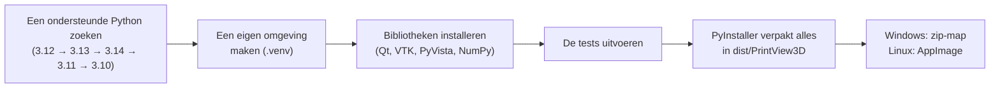

# Zelf bouwen

Alleen nodig als je de code wilt aanpassen of de kant-en-klare download niet wilt gebruiken.

## Stap 1: installeer de juiste Python-versie ⚠️ {#step-1-install-the-right-python-version}

PrintView3D gebruikt **VTK** voor het 3D-tekenen, en VTK ondersteunt alleen bepaalde Python-versies.
**De nieuwste Python wordt vaak *nog niet* ondersteund**, en de grote downloadknop op python.org geeft je altijd
de nieuwste.

| Python-versie | Werkt het? |
|---|---|
| 3.10, 3.11 | ✅ Ja |
| **3.12** | ✅ **Ja, aanbevolen** (dit gebruiken de officiële versies) |
| 3.13, 3.14 | ✅ Ja |
| 3.15 en nieuwer | ❌ Nog niet (er is nog geen VTK-versie voor) |

### Windows {#windows}

**Heb je al Python?** Kijk welke versies je hebt: open de *Opdrachtprompt* en typ `py --list`.

**Installeer Python 3.12** op een van deze manieren:

- **Het makkelijkst**, in de *Opdrachtprompt* of *PowerShell*:
  ```
  winget install Python.Python.3.12
  ```
- **Of** via python.org: ga naar [python.org/downloads/windows](https://www.python.org/downloads/windows/),
  zoek de nieuwste versie **Python 3.12.x** en download de *Windows installer (64-bit)*.
  Vink tijdens de installatie **"Add python.exe to PATH"** *alleen* aan als je geen andere Python hebt.

### Linux {#linux}

Controleer met `python3 --version`. Staat er 3.15 of nieuwer, installeer dan 3.12 ernaast:

| Distributie | Opdracht |
|---|---|
| Ubuntu / Mint / Pop!_OS | `sudo apt install python3.12 python3.12-venv` (op oudere Ubuntu eerst: `sudo add-apt-repository ppa:deadsnakes/ppa`) |
| Debian | `sudo apt install python3 python3-venv` (Debian 12/13 hebben een ondersteunde versie) |
| Fedora | `sudo dnf install python3.12` |
| Arch / Manjaro | `yay -S python312`, of gebruik [pyenv](https://github.com/pyenv/pyenv) |

Je hebt ook `curl` en `git` nodig (meestal al geïnstalleerd).

> Je kunt meerdere Python-versies naast elkaar hebben; ze zitten elkaar niet in de weg. De bouwscripts kiezen
> automatisch een ondersteunde versie (eerst 3.12), dus een nieuwere Python is geen probleem.

## Stap 2: haal de code op {#step-2-get-the-code}

Klik op de groene knop **Code → Download ZIP** op de [projectpagina op GitHub](https://github.com/sevagjb/PrintView3D)
en pak het uit, of:

```
git clone https://github.com/sevagjb/PrintView3D.git
```

## Stap 3: bouwen {#step-3-build}

**Windows:** dubbelklik op **`build_windows.bat`** in de projectmap (of start het vanuit een terminal).
Start daarna **`install_windows.bat`**. Is [Inno Setup 6](https://jrsoftware.org/isinfo.php) geïnstalleerd, dan
maakt het bouwen ook de installer `dist\PrintView3D-Setup.exe`.

**Linux:** in een terminal, in de projectmap:

```bash
./build_linux.sh          # makes dist/PrintView3D-x86_64.AppImage
./install_linux.sh        # optional: copy to ~/Applications + add to the applications menu
```

De eerste keer bouwen duurt een paar minuten (het downloadt zo'n 300 MB aan bibliotheken); daarna gaat het
sneller.

## Wat het bouwscript doet {#what-the-build-script-does}



1. **Python zoeken.** Het zoekt 3.12, dan 3.13, 3.14, 3.11, 3.10 (Windows: via de `py`-launcher; Linux:
   `python3.12`, `python3.13`, …) en gebruikt de eerste die het vindt. Is er geen geïnstalleerd, dan stopt het
   en zegt het wat je moet installeren.
2. **`.venv` maken.** Een eigen map met een eigen kopie van de bibliotheken, zodat er niets in je systeem-Python
   wordt geïnstalleerd en niets anders op je pc verandert. Verwijder `.venv` om opnieuw te beginnen.
3. **Bibliotheken installeren** uit `requirements.txt` (het programma) en `requirements-build.txt`
   (PyInstaller en pytest).
4. **De tests uitvoeren** in `tests/`. Het bouwen stopt als er een test mislukt.
5. **Verpakken.** PyInstaller verzamelt Python, de bibliotheken en het programma in
   `dist\PrintView3D\PrintView3D.exe` plus een map `_internal`. Die map is het kant-en-klare programma en werkt
   op elke pc met Windows 10/11 zonder Python. Hij is groot (honderden MB), vooral door de 3D-engine VTK.
6. **Alleen Linux: AppImage.** `build_linux.sh` downloadt één keer [appimagetool](https://github.com/AppImage/appimagetool)
   en verpakt `dist/PrintView3D/` in het ene bestand `dist/PrintView3D-x86_64.AppImage`. (`--no-appimage` slaat
   deze stap over.)

## Problemen bij het bouwen {#troubleshooting-the-build}

| Probleem | Oplossing |
|---|---|
| `No supported Python version was found` | Installeer Python 3.12 (stap 1). |
| `Python was not found` / `'py' is not recognized` | Installeer Python via python.org of winget (stap 1); beide hebben de `py`-launcher. |
| Linux: `Could not create a virtual environment` | Installeer de venv-module, bijv. `sudo apt install python3.12-venv`. |
| Linux: `qt.qpa.plugin: Could not load the Qt platform plugin "xcb"` bij starten vanuit de broncode | Installeer het X11-hulpje van Qt: `sudo apt install libxcb-cursor0` (Fedora: `xcb-util-cursor`). De AppImage bevat het al. |
| Het bouwen mislukt bij het installeren van `vtk` | Je gebruikt een Python die niet ondersteund wordt. Verwijder de map `.venv`, installeer 3.12 en bouw opnieuw. |
| Tests mislukken | [Meld het](https://github.com/sevagjb/PrintView3D/issues) en plak de uitvoer erbij. |
| Windows Defender verwijdert of blokkeert de `.exe` | Een bekend vals alarm bij PyInstaller-programma's. Sta het toe in *Windows-beveiliging → Beveiligingsgeschiedenis*. |

## Ontwikkelen {#developing}

```bat
run_from_source.bat                    :: start from the source code, no packaging (Linux: ./run_from_source.sh)
.venv\Scripts\python -m pytest -q      :: run the tests
.venv\Scripts\python tools\make_demo.py         :: regenerate examples\
.venv\Scripts\python tools\make_screenshots.py  :: regenerate the README pictures
```

```
src/printview3d/
  app.py              entry point and command-line options
  loaders/gcode.py    G-code reader (layers, feature types, print info, thumbnails)
  loaders/mesh.py     STL and 3MF readers, STL writer (Export STL)
  slicer.py           list of slicers, detection and launching
  file_assoc.py       "Open with" / default app (assoc_windows.py: registry, assoc_linux.py: freedesktop)
  gpu.py              graphics-card info and high-performance GPU setting
  settings.py         settings file: %APPDATA%\PrintView3D\settings.json
  ui/                 window, 3D scene, camera controls, settings dialog, theme
tests/                automated tests and sample files
tools/                demo-file and screenshot generators
packaging/linux/      AppImage launcher and menu entry
printview3d.spec      PyInstaller recipe (Windows and Linux)
```

**Automatisch bouwen:** elke push bouwt en test het programma op GitHub
([Actions](https://github.com/sevagjb/PrintView3D/actions)). Verandert het versienummer in
`src/printview3d/__init__.py`, dan wordt er ook een nieuwe [versie](https://github.com/sevagjb/PrintView3D/releases)
gepubliceerd met de bestanden voor Windows, Linux en macOS.

## Opdrachtregel {#command-line}

```
PrintView3D.exe model.stl                          open a file (in the window already open, if any)
PrintView3D.exe model.stl --new-window             open a file in a new window
PrintView3D.exe part.gcode --screenshot out.png    save a picture and exit
                     [--layer 25] [--view iso|top|front|right]
PrintView3D.exe model.stl --send-to-slicer         open the file in your default slicer and exit
PrintView3D.exe model.stl --send-to-slicer orcaslicer   ...or in a specific one
PrintView3D.exe --lang ar                          start in a language (en, ar, nl, de, fr, es)
PrintView3D.exe --theme light                      start with a theme (auto, dark, gray, graphite, light)
PrintView3D.exe --register                         add to "Open with" (Linux: also the applications menu)
PrintView3D.exe --unregister                       remove file associations
(on Linux use ./PrintView3D-x86_64.AppImage instead of PrintView3D.exe)
```

(Op volgorde: een bestand openen (in het venster dat al open is, als dat er is); een bestand in een nieuw venster
openen; een afbeelding opslaan en afsluiten; het bestand in je standaardslicer openen en afsluiten, of in een
bepaalde slicer; starten in een taal; starten met een thema; toevoegen aan "Openen met"; bestandskoppelingen
verwijderen. Gebruik op Linux `./PrintView3D-x86_64.AppImage` in plaats van `PrintView3D.exe`.)
