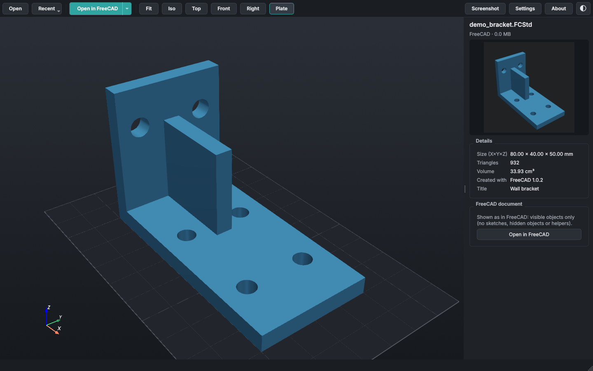
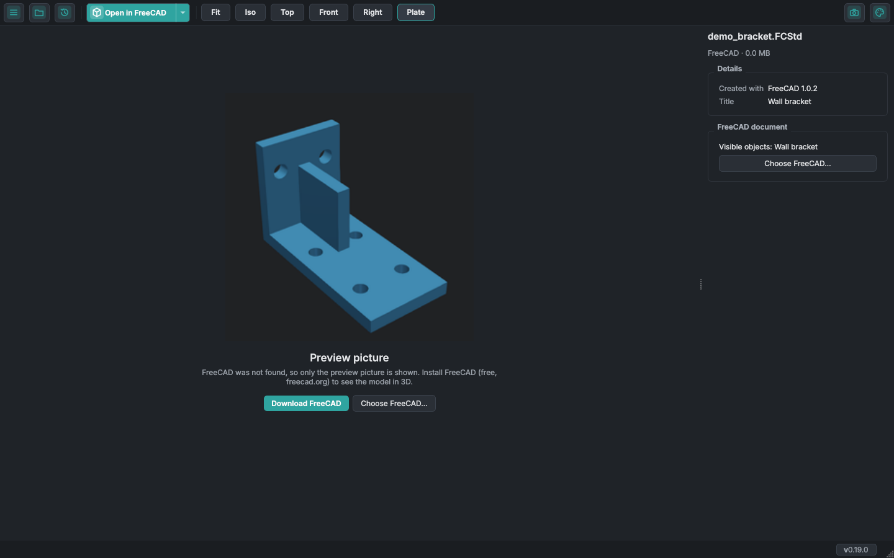

# FreeCAD و STEP وصيغ أخرى

## ملفات FreeCAD {#freecad-files}

افتح مستند FreeCAD ‏(`.FCStd`) بزر **فتح** أو اسحبه وأفلته في النافذة
(لا يأخذ PrintView3D النقر المزدوج من FreeCAD).
هو للعرض فقط؛ لا يتغيّر أي شيء في الملف.

- **مع تثبيت FreeCAD** (مجاني، [freecad.org](https://www.freecad.org/downloads.php)) يظهر النموذج ثلاثي
  الأبعاد كما يعرضه FreeCAD: الأجسام والمجسّمات الظاهرة فقط، دون الرسومات التخطيطية والأجسام المخفية
  ومستويات المرجع. يشغّل PrintView3D برنامج FreeCAD بشكل خفي في الخلفية لتحويل الأشكال (بضع ثوانٍ في
  المرة الأولى؛ ثم يُحفَظ حتى يتغيّر الملف).
  يصبح الزر الكبير **فتح في FreeCAD**، ويرسل السهم ▾ النموذج الظاهر إلى برنامج التقطيع بصيغة STL.
- **دون FreeCAD** ترى صورة المعاينة في الملف، وإصدار FreeCAD والأجسام الظاهرة، مع زر لتنزيل FreeCAD.

يُعثَر على FreeCAD تلقائيًا في أماكنه المعتادة (مثبّت Windows، وحزم Linux، وSnap، وFlatpak، وAppImage).
إذا كان في مكان آخر، فاختره في **الإعدادات ← FreeCAD**.

لأن FreeCAD نفسه هو من يفتح الملف، فإن ملف FreeCAD أو STEP يستحق الثقة نفسها كما لو فتحته في FreeCAD:
افتح الملفات من أشخاص ومواقع تثق بها.

<table>
<tr>
<td width="50%"> مع تثبيت FreeCAD: القطعة ثلاثية الأبعاد.</td>
<td width="50%"> دون FreeCAD: صورة المعاينة المحفوظة في الملف.</td>
</tr>
</table>

## ملفات STEP {#step-files}

STEP ‏(`.step` و`.stp`) هي الصيغة الشائعة لتبادل نماذج CAD بين البرامج. تحفظ أشكالًا دقيقة (أسطحًا
منحنية)، لا مثلثات، لذلك يستخدم PrintView3D برنامج **FreeCAD** لتحويلها إلى شبكة مثلثات، بالطريقة نفسها
كما في [ملفات FreeCAD](#freecad-files): بشكل خفي في الخلفية، بضع ثوانٍ في المرة الأولى، ثم يُحفَظ حتى
يتغيّر الملف.

- **الأجزاء:** تُدرَج أجزاء التجميعة منفصلة بأسمائها من الملف، ويمكن إخفاؤها. (إذا أعطى استيراد FreeCAD
  نتيجة غير متوقعة، يعرض PrintView3D كل مجسّم على حدة بدلًا من ذلك، فيبقى الشكل صحيحًا دائمًا.)
- **دون FreeCAD** ترى مع ذلك التفاصيل من الملف (إصدار STEP، وبرنامج CAD الذي صُنع به، والمؤلف، والجهة،
  والتاريخ) وزرًا لتنزيل FreeCAD.
- **الإرسال إلى برنامج التقطيع:** يفتح OrcaSlicer وPrusaSlicer وBambu Studio ملفات STEP بأنفسها وتحصل على
  الملف كما هو (حتى دون FreeCAD). وتحصل برامج التقطيع الأخرى على الأجزاء الظاهرة بصيغة STL، وهذا يحتاج إلى
  FreeCAD.
- تُضاف ملفات STEP إلى **فتح باستخدام**، لكن PrintView3D لا يجعل نفسه أبدًا التطبيق الافتراضي لها.

## صيغ ثلاثية الأبعاد أخرى {#other-3d-formats}

| الصيغة | ما يُقرأ | يُرسَل إلى برنامج التقطيع بصيغة |
|---|---|---|
| **OBJ** ‏(`.obj`) | الكائنات (`o`) أو المجموعات (`g`) كأجسام منفصلة؛ والألوان من ملف `.mtl` المجاور، أو ألوان الرؤوس. | ملف `.obj` نفسه |
| **PLY** ‏(`.ply`) | نصي وثنائي؛ ألوان الرؤوس أو الأوجه. لا يمكن عرض سُحب النقاط (دون أوجه). | STL |
| **OFF** ‏(`.off`) | ملفات نصية (وCOFF أيضًا)، مع ألوان الرؤوس أو الأوجه. | STL |
| **glTF / GLB** ‏(`.gltf` و`.glb`) | كل جسم في المشهد في موضعه، بلون مادته أو ألوان رؤوسه. | STL |

- **الأبعاد:** لا وحدات في OBJ وPLY وOFF؛ يعامل PrintView3D الأرقام كمليمترات، كما تفعل برامج التقطيع.
  إذا ظهر نموذج صغيرًا جدًا، فالملف على الأرجح مصنوع بالأمتار؛ ويمكن لبرنامج التقطيع تكبيره.
  أما glTF فهو دائمًا بالأمتار ويُعرض بالمليمترات (مع المحور Z للأعلى، كما في الطابعة).
- **لا يُقرأ:** الخامات (صور على النموذج)، والحركات، وملفات glTF المضغوطة بـ Draco أو meshoptimizer
  (يخبرك PrintView3D بذلك؛ صدّرها مجددًا دون ضغط).
- تُضاف هذه الأنواع إلى **فتح باستخدام**، لكن PrintView3D لا يجعل نفسه أبدًا التطبيق الافتراضي لها.
