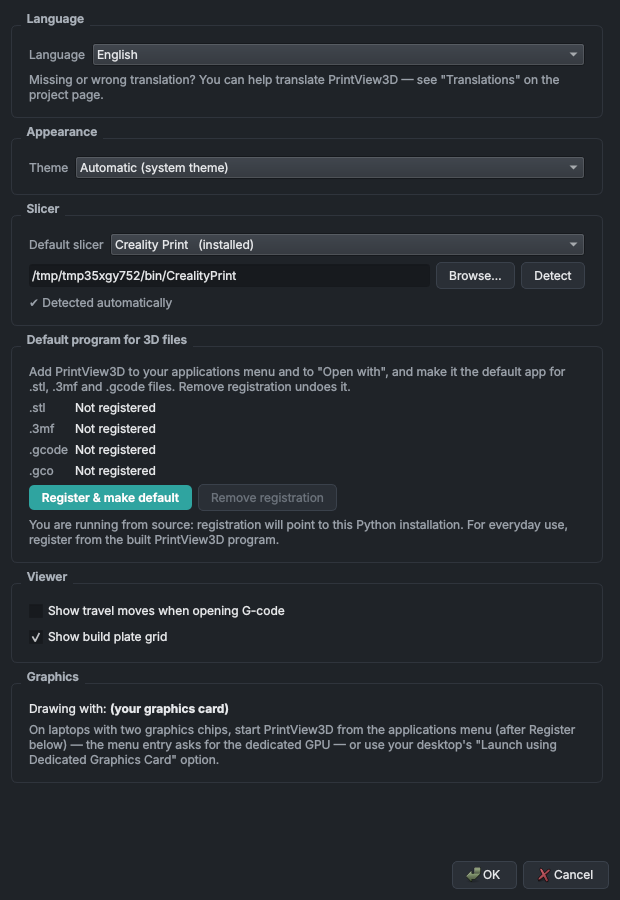
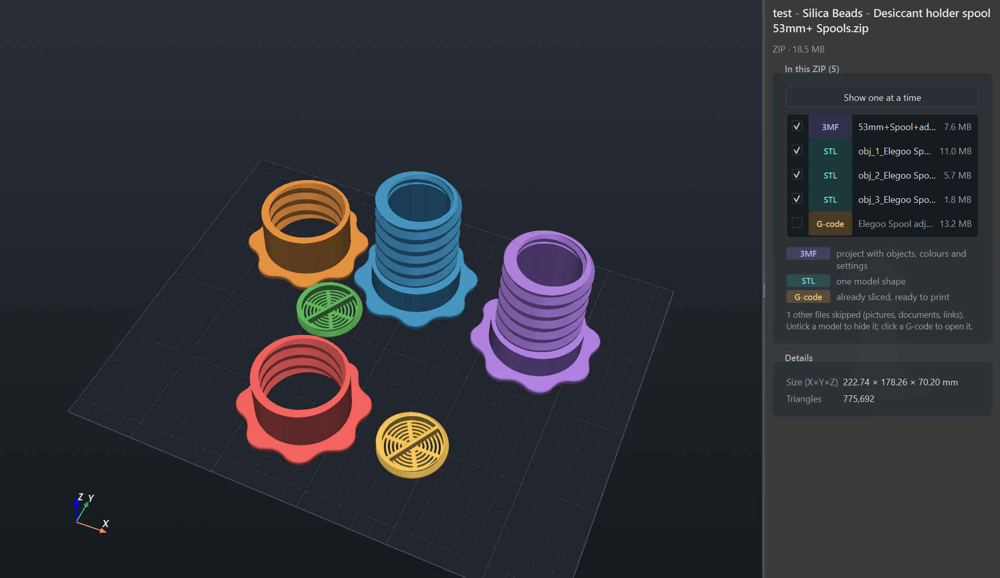
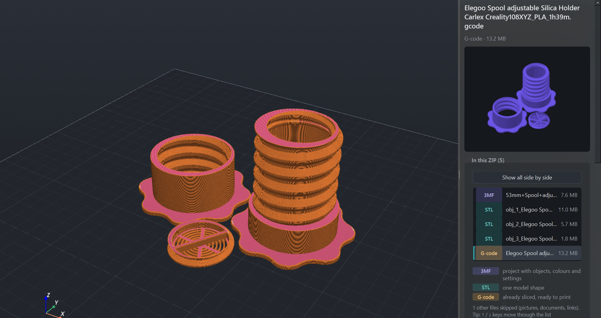
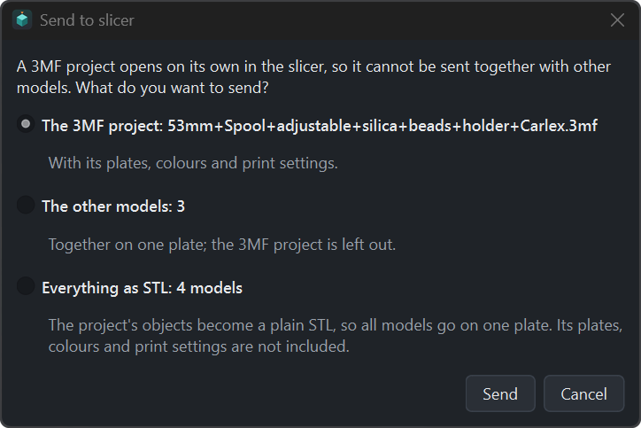
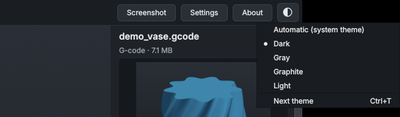
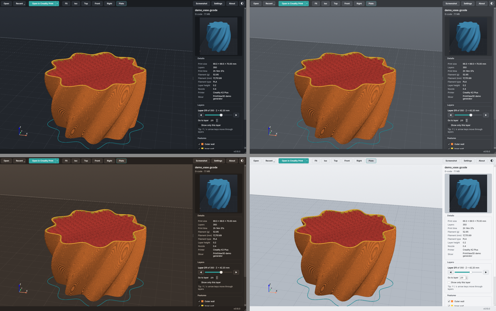
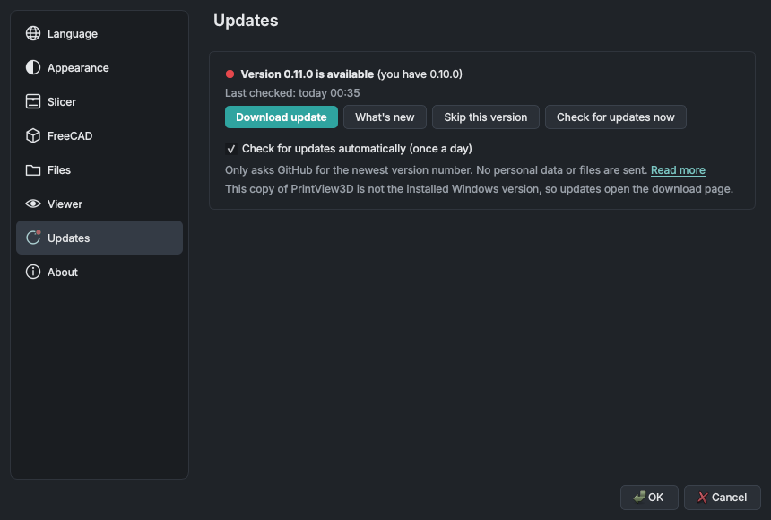

# استخدام PrintView3D

**فتح ملف:** انقر عليه نقرًا مزدوجًا (إذا كان PrintView3D هو البرنامج الافتراضي)، أو اسحبه إلى النافذة، أو
استخدم **فتح**، أو اختره من **الأخيرة**. جرّب الملفات في [`examples/`](https://github.com/sevagjb/PrintView3D/blob/main/examples) للبدء.

**الرئيسية:** زر المنزل (`Ctrl+W`) يغلق الملف المفتوح ويعود إلى صفحة البداية مع ملفاتك الأخيرة.
ويعيد أيضًا الذاكرة التي استخدمها الملف، وهذا يُحدث فرقًا خاصةً بعد ملف G-code أو ZIP كبير.

**نافذة واحدة:** الملف الذي تنقر عليه نقرًا مزدوجًا أثناء فتح PrintView3D يظهر في النافذة نفسها، وتنتقل
هذه النافذة إلى الواجهة. لتعطي كل ملف نافذته الخاصة (لمقارنة نموذجين جنبًا إلى جنب)، فعّل
**الإعدادات ← الملفات ← فتح كل ملف في نافذة جديدة**. تشغيل PrintView3D من قائمة ابدأ أو قائمة التطبيقات
دون ملف يفتح دائمًا نافذة جديدة.

## الماوس {#mouse}

| الحركة | ما تفعله |
|---|---|
| **السحب بالزر الأيسر** | تدوير. اضغط *على النموذج* للتدوير حول تلك النقطة بالضبط؛ واضغط على مساحة فارغة للتدوير حول مركز النموذج. تبقى اللوحة أفقية دائمًا. |
| **السحب بالزر الأيمن** (أو بالزر الأوسط، أو Shift + الزر الأيسر) | تحريك (إزاحة) |
| **عجلة الماوس** | تكبير وتصغير باتجاه مؤشر الماوس |

تنظر من الأسفل؟ تبتعد اللوحة عن الطريق لترى أسفل القطعة.

## لوحة المفاتيح {#keyboard}

القائمة نفسها موجودة في البرنامج تحت **الإعدادات ← حول ← لوحة المفاتيح والماوس**.

| المفتاح | الإجراء |
|---|---|
| `Ctrl+O` | فتح ملف |
| `Ctrl+W` | إغلاق الملف (العودة إلى صفحة البداية) |
| `Ctrl+P` | فتح الملف في برنامج التقطيع الافتراضي |
| `Ctrl+E` | تصدير STL (مشاريع 3MF وملفات FreeCAD وSTEP) |
| `Ctrl+T` | السمة التالية (داكن ← رمادي ← غرافيت ← فاتح) |
| `F` · `1` · `2` · `3` · `4` | ملاءمة · متساوي القياس · أعلى · أمام · يمين |
| `↑` / `↓` | الطبقة التالية / السابقة (G-code)، أو الملف السابق / التالي في ملف ZIP |
| `Page Up` / `Page Down` | ‏10 طبقات للأعلى / للأسفل |
| `Home` / `End` | الطبقة الأولى / الأخيرة |

## اختيار برنامج التقطيع {#choosing-your-slicer}

**الإعدادات ← برنامج التقطيع ← برنامج التقطيع الافتراضي.** كل برنامج تقطيع مُعلَّم بأنه *مثبّت* أو *غير
موجود*. إذا كان برنامجك مثبّتًا في مكان غير معتاد، فانقر **استعراض…** واختر ملف البرنامج. ولبرنامج تقطيع
غير موجود في القائمة، اختر **برنامج مخصص…**، وأعطه اسمًا، واختر ملف `.exe` الخاص به.

يتغيّر اسم الزر الأخضر ليطابقه («فتح في OrcaSlicer»). والسهم الصغير **▾** بجانبه يعرض برامج التقطيع
الأخرى المثبّتة لديك، لفتح ملف في أحدها لمرة واحدة.

## تصدير STL من 3MF {#export-stl-from-3mf}

عند فتح مشروع 3MF، يحفظ زر **تصدير STL** في شريط الأدوات (`Ctrl+E`) أجسامه كملفات STL عادية، مثلًا
لمشاركة نموذج أو فتحه في برنامج لا يقرأ 3MF.

- تعرض نافذة حوار كل جسم باسمه وعدد مثلثاته، وكلها محدّدة؛ ألغِ تحديد ما لا تحتاجه.
- **السهم بجانب الزر** يعرض كل الطرق مباشرةً: *كل الأجسام في ملف STL واحد* و*ملف STL لكل جسم* و*اختيار
  الأجسام…* (نافذة الحوار). الخيار الذي تنفّذه النقرة يظهر بخط عريض.
- **ما تفعله النقرة** (و`Ctrl+E`) تختاره من **الإعدادات ← الملفات ← تصدير STL**: عرض قائمة الأجسام
  (الافتراضي)، أو حفظ الكل في ملف STL واحد، أو حفظ ملف STL لكل جسم. ويفتح *تغيير ما تفعله النقرة…* في أسفل
  قائمة السهم هذا الإعداد.
- **ملف STL واحد مجمّع**: الأجسام المحدّدة في ملف واحد، بأماكنها على اللوحة.
- **ملف STL لكل جسم**: يُسمّى كل ملف باسم جسمه ويُحفَظ في مجلد تختاره (يسألك PrintView3D قبل استبدال
  ملفات موجودة).
- الملف الذي فيه جسم واحد فقط ينتقل دائمًا مباشرةً إلى نافذة الحفظ.
- **الشكل الهندسي الخام فقط:** تُستبعد المُعدِّلات والأجزاء السالبة ومانعات / فارضات الدعامات (كما
  سجّلها Creality Print وOrcaSlicer وBambu Studio وPrusaSlicer)، وكذلك الألوان والمواد وإعدادات الطباعة.
  الأبعاد بالمليمتر؛ والملفات بصيغة STL ثنائية.

## ملفات ZIP {#zip-files}

غالبًا ما تأتي النماذج المنزّلة في ملف ZIP. افتحه كأي ملف آخر (**فتح…** أو اسحبه إلى النافذة)؛ لا حاجة
إلى فك ضغطه أولًا.

<table>
<tr>
<td width="50%"> <b>عرض الكل جنبًا إلى جنب</b>: حدّد أي نموذج أو ألغِ تحديده؛ ملف G-code يُفتح بمفرده.</td>
<td width="50%"> انقر على ملف في القائمة، أو استخدم ↑ / ↓: هنا ملف G-code المقطّع من ملف ZIP نفسه.</td>
</tr>
</table>

- **تُستخدم الملفات ثلاثية الأبعاد فقط**: STL و3MF وOBJ وPLY وOFF وglTF/GLB وSTEP وFreeCAD وG-code.
  تُتجاهل الصور وملفات PDF وملفات اقرأني وروابط الويب وملفات ZIP داخل ملف ZIP والمجلد المخفي
  `__MACOSX`، وتذكر اللوحة عدد ما تم تجاهله.
- **ملف ZIP فيه ملف ثلاثي الأبعاد واحد** يُفتح تمامًا مثل ذلك الملف.
- **الملفات الأكثر** تُدرَج في اللوحة الجانبية مع شارة ملوّنة لنوعها (STL و3MF وG-code و…) وشرح قصير لكل
  نوع. يظهر الملف الأول؛ انقر على ملف آخر، أو استخدم **↑ / ↓**، للتبديل.
- **عرض الكل جنبًا إلى جنب** يضع النماذج بجانب بعضها: حتى ثلاثة في صف واحد، ثم شبكة (أربعة كـ 2 × 2،
  وستة كـ 3 × 2، وتسعة كـ 3 × 3، …)، متباعدة حسب حجمها الحقيقي. ألغِ تحديد النماذج في **الأجسام**
  لإخفائها. تُفتح ملفات G-code وSTEP وFreeCAD واحدًا تلو الآخر.
- **فتح في برنامج التقطيع** يرسل النموذج الذي تنظر إليه؛ وفي «عرض الكل»، النماذج المحدّدة. وفي السهم
  بجانب الزر خيار **إرسال كل نماذج ملف ZIP**.
- يفتح برنامج التقطيع **ملف 3MF كمشروع مستقل**، لذلك لا يمكنه أخذ ملف 3MF مع ملفات أخرى. عندما تتضمن
  النماذج المرسَلة ملف 3MF، يسألك PrintView3D: مشروع 3MF (بلوحاته وإعداداته)، أو النماذج الأخرى على لوحة
  واحدة، أو **كل شيء بصيغة STL** (تصبح أجسام المشروع ملف STL عاديًا، فتذهب كل النماذج إلى لوحة واحدة).

    

تُفك الملفات ثلاثية الأبعاد في مجلد التخزين المؤقت الخاص بـ PrintView3D (برامج التقطيع تحتاج إلى ملفات
حقيقية)؛ وتُفحَص الأحجام أولًا، فلا يستطيع ملف ZIP تالف أو خبيث ملء القرص. وتُحذف تلقائيًا ملفات ZIP
التي فُتحت قبل أكثر من يوم.

## اللغة {#language}

**الإعدادات ← اللغة** تغيّر لغة البرنامج كله فورًا، بما في ذلك نوافذ الملفات والأزرار القياسية. الإنجليزية
هي الافتراضية؛ و*تلقائي* يتبع لغة نظامك. تستخدم العربية تخطيطًا من اليمين إلى اليسار؛ وتُكتب القياسات
دائمًا بالأرقام الغربية (0.20 mm).
كلمة خاطئة أو ناقصة؟ الرابط في تلك الصفحة يقودك إلى [كيف تترجم](TRANSLATING.md).

## السمات {#themes}

انقر **أيقونة لوحة الألوان** في الطرف الأيمن من شريط الأدوات لاختيار سمة، أو اضغط **`Ctrl+T`** للانتقال
إلى السمة التالية. الخيار نفسه موجود في **الإعدادات ← المظهر ← السمة**.

- **تلقائي** يتبع إعداد الوضع الداكن/الفاتح في Windows أو في سطح مكتب Linux (ويتغيّر معه).
- **داكن** أو **رمادي** أو **غرافيت** (لون بني داكن دافئ مريح للعين) أو **فاتح**.

التبديل فوري؛ تتغيّر معه خلفية العرض ثلاثي الأبعاد واللوحة والشبكة، بينما تبقى ألوان G-code والنماذج كما
هي لتطابق برنامج التقطيع دائمًا.

### شفافية النافذة (Windows 11) {#window-transparency-windows-11}

**الإعدادات ← المظهر ← شفافية النافذة** تجعل شريط الأدوات واللوحة الجانبية وشريط الحالة تُظهر ما خلف
النافذة، في أي سمة:

- **Mica**: لون خفيف من خلفية سطح المكتب (كما في مستكشف الملفات).
- **Acrylic**: زجاج مصنفر يطمس سطح المكتب والنوافذ الأخرى خلفه.
- **إيقاف** (الافتراضي): خلفية ثابتة، كما كانت.

يبقى العرض ثلاثي الأبعاد ثابتًا دائمًا. يسري التغيير بعد إعادة التشغيل: عند النقر على OK يسألك
PrintView3D: **إعادة التشغيل الآن** (يُغلَق ويُفتح من جديد بالملف نفسه) أو **لاحقًا**. يرسم Windows التأثير
بنفسه ويعرض لونًا عاديًا عندما لا تكون النافذة نشطة، ويوقفه عند إيقاف *Transparency effects* في إعدادات
Windows أو في وضع توفير البطارية. يحتفظ Windows 10 والأنظمة الأخرى بالشكل العادي.

## التحديثات {#updates}

**الإعدادات ← التحديثات** تعرض إصدارك وفيها **التحقق من التحديثات الآن**. يمكنك أيضًا تفعيل
**التحقق من التحديثات تلقائيًا (مرة يوميًا)**؛ يسألك PrintView3D مرة واحدة إن كنت تريد ذلك، ويمكنك تغييره
هناك في أي وقت.

عند وجود إصدار جديد، يظهر بجانب رقم الإصدار في الزاوية السفلية اليمنى **نقطة حمراء** (`● v0.10.0 →
0.11.0`)، وكذلك بجانب *التحديثات* في الإعدادات. انقر عليها لترى **ما الجديد**، ثم:

- **Windows (مثبّت بواسطة Setup.exe): تثبيت التحديث.** ينزّل PrintView3D المثبّت الجديد، ويتحقق من بصمة
  SHA-256 الخاصة به مقارنةً بالبصمة التي ينشرها GitHub، ويثبّته (دون أسئلة، مع الاحتفاظ بإعداداتك) ثم
  يشغّل الإصدار الجديد.
- **Linux ‏(AppImage) ونسخة Windows المحمولة: تنزيل التحديث** يفتح صفحة الإصدار؛ نزّل الملف الجديد وضعه
  مكان القديم.
- **تخطي هذا الإصدار** يخفي ذلك الإصدار؛ ويظهر الإصدار الذي يليه من جديد.

بعد التحديث، يعرض أول تشغيل **ما الجديد** للإصدار الذي لديك الآن، مرة واحدة، أيًّا كانت طريقة التحديث
(المثبّت أو winget أو ملف zip أو AppImage). يُقرأ من سجل التغييرات المرفق بالبرنامج، فلا يحتاج إلى اتصال.
ولا يظهر بعد تثبيت جديد.

### التحديثات والخصوصية {#updates-and-privacy}

يعمل PrintView3D دون اتصال. لا يتصل بالإنترنت **إلا** للتحديثات، وفقط عندما تنقر *التحقق من التحديثات
الآن* أو تفعّل التحقق اليومي:

| | |
|---|---|
| **بماذا يتصل** | `api.github.com` (للسؤال عن أحدث إصدار من هذا المشروع)، وعند النقر على *تثبيت التحديث*، التنزيل من `github.com` |
| **كم مرة** | مرة يوميًا على الأكثر (التحقق التلقائي)، أو عندما تنقر *التحقق من التحديثات الآن* |
| **ما الذي يُرسَل** | طلب أحدث إصدار فقط، مع اسم البرنامج وإصداره (`PrintView3D/0.10.0`). لا بيانات شخصية، ولا ملفات، ولا إحصاءات استخدام، ولا معرّف. |
| **ما يراه GitHub** | مثل أي موقع: عنوان IP الخاص بك. راجع [بيان الخصوصية لدى GitHub](https://docs.github.com/site-policy/privacy-policies/github-general-privacy-statement). |
| **كيف توقفه** | الإعدادات ← التحديثات ← ألغِ تحديد *التحقق من التحديثات تلقائيًا*. لا يتصل بشيء بعد ذلك. |

## تدوير أنعم على الحواسيب المحمولة {#smoother-rotation-on-laptops}

في كثير من الحواسيب المحمولة شريحتا رسوميات، وتعمل البرامج افتراضيًا على الأبطأ منهما.
**الإعدادات ← العارض ← الرسوميات** تعرض أيّهما يستخدم PrintView3D. إذا كانت *Intel*، ففعّل
**استخدام بطاقة الرسوميات عالية الأداء** وانقر OK؛ ثم اختر **إعادة التشغيل الآن** (أو **لاحقًا**، فيتم
التبديل في المرة التالية التي تشغّل فيها PrintView3D).

## ملاحظات وحدود {#notes-and-limits}

- نسختا Windows 10/11 وLinux ‏(x86-64) مُحزَّمتان ومختبرتان. نسختا Mac ‏(Apple silicon وIntel، ‏macOS 14.4+)
  [تجريبيتان](install.md#macos). ولا توجد حزمة لـ Linux على ARM ‏(Raspberry Pi وغيره) بعد.
- قد يفقد *مشروع* 3MF محفوظ في برنامج تقطيع من شركة ما إعدادات الطابعة/الطباعة عند فتحه في برنامج من شركة
  أخرى. النموذج نفسه يُحمَّل بشكل سليم؛ هكذا تتصرف برامج التقطيع.
- ملفات G-code الثنائية (`.bgcode`) غير مدعومة بعد.
- الصور المصغّرة في مستكشف الملفات متاحة لملفات 3MF وSTL وG-code وFreeCAD؛ وليس بعد لـ OBJ وPLY وOFF
  وglTF.
- تحتاج مستندات FreeCAD إلى FreeCAD مثبّت للعرض ثلاثي الأبعاد (لا يتضمن PrintView3D محرّك الأشكال الهندسية
  الخاص بـ FreeCAD). قد لا تفتح إصدارات FreeCAD القديمة جدًا أو الحديثة جدًا ملفات بعضها.
